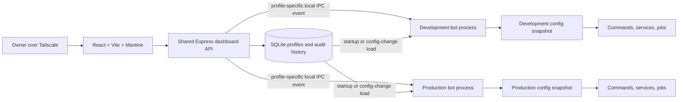

# Hellbot Admin Dashboard Architecture Plan

## Status

Planning only. This document records the agreed direction; implementation details can be refined while building.

## Goal

Build a private dashboard in the Hellbot monorepo to manage Hellbot-specific runtime settings for separate development and production bot instances. The owner selects a profile in the dashboard. Each bot runs under PM2 with its own Discord application and token, reads its own persisted configuration, and keeps a validated in-memory snapshot for fast runtime reads.

The dashboard should expose application behavior and operational controls that belong to Hellbot. It should not duplicate generic Discord server settings for guilds, channels, or roles.

## Agreed architecture

- Keep the dashboard, admin API, and bot code in the Hellbot monorepo.
- Run two separate Hellbot bot processes under PM2: one for development and one for production. Each process is bound to its own profile and Discord application.
- Run one shared Express admin API/dashboard process under PM2. It serves the production Vite build, validates and persists changes, and notifies the affected bot process.
- Build the UI with React, Vite, and Mantine.
- Use SQLite on the same server as the initial persistent database, outside the repository.
- Treat SQLite as the source of truth. Each bot keeps a validated, profile-scoped in-memory snapshot; commands and services do not query the database on every use.
- Make the dashboard reachable only over the owner's Tailscale network.

The dashboard profile selector chooses which bot configuration to edit. It does not switch a running Discord client between bot identities. Each PM2 bot process remains connected to its own Discord app.

## Component layout



During local development, Vite may run separately and proxy API requests to the dashboard API. In production, the API serves the static dashboard bundle. The API and each bot run as separate PM2 processes so development and production have independent Discord clients and configuration lifecycles.

## Configuration lifecycle

### Startup

1. The API and bot processes open the shared SQLite database and apply migrations.
2. Each bot process loads and validates only its own profile's persisted settings.
3. The bot creates an in-memory snapshot with documented defaults for unset values.
4. The bot starts listeners, provider clients, and scheduled jobs using that snapshot.
5. The dashboard API serves the UI and API routes.

### Dashboard update

1. The UI submits a typed change for the selected profile.
2. The API validates the profile, setting, and value; unknown fields and invalid values are rejected.
3. The API commits the new value and records a sanitized audit entry in a database transaction.
4. After commit, the API sends a local IPC notification to the corresponding bot process. Shared AI key changes notify both bot processes.
5. That bot reloads and validates its profile once, atomically replaces its in-memory snapshot, and emits an in-process change event.
6. Affected services update live. Scheduled jobs that depend on changed values are cancelled and recreated where needed.

There is no periodic database polling and no database query per command or event. A database read happens at startup and after a successful configuration-change notification. If the notification or reload fails after the save, the dashboard should show that the setting is saved but not yet applied; the bot can recover from the persisted value on restart.

## Runtime configuration rules

- Add a ConfigService as the single interface for reading and changing runtime settings.
- Ordinary settings belong to a profile. AI provider keys are shared between dev and prod; control-plane configuration is also shared.
- Consumers should read settings from the current profile snapshot when they run; avoid module-level copies for values expected to change live.
- Validate and atomically replace each profile snapshot. A failed save or invalid reload must leave the last valid snapshot active.
- Use one in-process event for consumers within a bot and one explicit local IPC event for cross-process notification.
- Classify settings before exposing them in the UI:
  - **Live:** provider, model, API key, prompts, prefix, embed color, supported feature switches, and Hellbot feature routing where consumers can safely refresh.
  - **Restart required:** Discord bot token, gateway intents, or other startup-only connection behavior. Discord bot tokens remain PM2 environment secrets; changing them is an operational deployment action.
  - **Protected control-plane:** owner identity and dashboard access policy. Changes require a separate, strongly authorized flow and audit entry.
  - **Secret:** AI provider keys are shared between dev and prod and encrypted at rest. The encryption key remains in the process environment wherever decryption is required. Secret values are never returned in API responses or audit history.

## Hellbot-specific settings in dashboard scope

The dashboard manages application-owned behavior, not general Discord server configuration. Candidate settings are scoped to the selected development or production profile where appropriate.

| Setting | Dashboard treatment | Runtime behavior |
| --- | --- | --- |
| AI provider | Select from providers supported by Hellbot | Recreate or reconfigure the profile's provider client after save. |
| AI provider API keys | Add, replace, test, or clear shared keys used by both dev and prod; display only configured/masked state | Store encrypted values and notify both bots after changes. Never return raw keys or include them in logs/audit records. |
| AI model | Select a model supported by the selected provider | Apply to subsequent AI requests. |
| System prompts | Edit the supported prompt templates per profile; validate required placeholders and provide preview/version history | Apply to subsequent AI calls after snapshot refresh. |
| Prefix command prefix | Editable validated text value | Applies to future prefix parsing and help output. |
| Role-request flow routing | Configure only the request/review destinations needed by Hellbot's role-request workflow | Applies to subsequent role requests and review interactions; this is a narrow Hellbot integration setting, not a general channel editor. |
| Embed color | Editable validated color value | Applies to embeds generated after the update. |
| Hellbot feature switches | Enable/disable explicitly supported Hellbot features | Each switch defines whether commands, listeners, or jobs stop immediately and how in-flight work is handled. |
| Other Hellbot-owned runtime settings | Add only after a code/config consumer audit confirms the setting is application-specific and has a safe runtime update path | Classify as live, restart-required, protected, or secret before exposing it. |

Do not expose generic per-profile guild, channel, or role configuration, nor controls that duplicate Discord's own server settings. A narrow Hellbot-owned integration value such as the destination used by the role-request workflow may be exposed only because it controls Hellbot behavior and is not general server administration.

Treat the Hellbot owner identity and dashboard access policy as protected control-plane settings, not ordinary profile fields. Protect changes with strong authorization, explicit confirmation, and audit history; prevent a routine edit from removing the only dashboard administrator. Tailscale remains the network-level access boundary.

## Errors and logs

Include an operational view for Hellbot errors and application logs, scoped by the selected bot profile. This is observability, not configuration editing.

- Show recent structured log entries and errors with timestamp, severity, profile, source, and useful command/service context.
- Support filters by time range, severity, profile, and component or command.
- Redact Discord bot tokens, AI provider keys, and other secrets before logs are written or returned by the API.
- Define retention and storage limits. Use rotating local structured logs or another bounded store; do not grow the configuration database indefinitely with log events.
- Distinguish local application logs from Bugsnag events. Audit actual Bugsnag reporting and current logging first; the dashboard must not imply it can show events the application does not capture.

## Proposed repository layout

```text
src/
  dashboard/
    api/                 # Express routes and request handlers
    middleware/          # Tailscale-aware access, authorization, validation
  services/
    config/              # Profile ConfigService, schema, defaults, change events
    database/            # SQLite connection and migrations
    ipc/                 # Local profile-specific bot notifications
  ...
dashboard/
  src/                   # React pages and Mantine-based UI
  public/                # Static public assets
  vite.config.js
```

The actual file layout should follow the existing Hellbot organization where practical and avoid a broad source-tree migration.

## Technology stack

### Backend

- **Express** for the shared admin API and serving the production dashboard bundle.
- **SQLite** for profile settings, shared encrypted AI secrets, and audit history.
- **Zod** for validating API input and configuration values. The backend remains CommonJS to match the bot.
- A SQLite Node.js driver and migration approach will be selected during implementation after checking the VPS Node.js version and deployment setup.
- A local IPC mechanism (for example, Unix domain sockets) will notify only the bot profile affected by a saved update; select the concrete transport during implementation.

### Frontend

- **React** for dashboard screens and interactive forms.
- **Vite** for local development and production asset builds.
- **Mantine** for layout, controls, forms, dialogs, and notifications.
- **@tabler/icons-react** for icons.
- A persistent profile selector for development and production, with clear visual indication of which environment is currently being edited.

The dashboard is a Vite frontend in the same repository, built and served by the Express API process in production. The existing bot processes remain CommonJS JavaScript; the frontend language can be finalized when scaffolding it.

## Database model and persistence

The initial database should contain:

- A profile-scoped configuration record with an update timestamp; no revision field.
- Shared encrypted secret values organized by provider, used by both dev and prod; never include their plaintext in API responses or audit data.
- An audit history with profile, changed setting paths, actor, timestamp, and previous/new non-secret values. For secret changes, record only that a secret was added, replaced, tested, or cleared.
- A schema migration version.

Use a persistent data directory outside the repository. Configure SQLite for the expected local multi-process access pattern (including appropriate busy handling and journaling mode) and keep writes short. Do not use the database as an unbounded application log store.

### Database architecture

#### `profiles`

Each row represents one bot profile. Use an integer primary key; the environment is a separate field, not the profile ID.

| Column | SQLite type | Constraints / purpose |
| --- | --- | --- |
| `id` | INTEGER | Primary key, generated by SQLite. |
| `env` | TEXT | Required, unique; allowed values: `dev`, `prod`. |
| `name` | TEXT | Required; display name in the dashboard profile selector. |
| `profile_image_url` | TEXT | Nullable; URL of the bot profile picture displayed in the dashboard. |
| `created_at` | TEXT | Required; UTC creation timestamp. |
| `updated_at` | TEXT | Required; UTC last-update timestamp. |

Other profile-scoped tables reference `profiles.id` through an integer `profile_id` foreign key.

#### `profile_configs`

One row per profile, containing the validated configuration without secrets. No revision counter or configuration versioning mechanism is needed initially.

| Column | SQLite type | Constraints / purpose |
| --- | --- | --- |
| `profile_id` | INTEGER | Primary key and foreign key to `profiles.id`. |
| `config_json` | TEXT | Required; JSON settings validated through Zod. |
| `updated_at` | TEXT | Required; UTC last-update timestamp. |

The JSON contains provider/model selection, prompts, prefix, embed color, and supported feature switches. These do not need separate tables initially.

The frontend submits only changed fields. Within a transaction, the backend reads the current configuration, merges those fields, validates the result, and saves it together with the history entry. This prevents a stale form from overwriting unrelated changes made in another tab, without adding a revision field. Concurrent edits to the same field use the last saved value.

#### `secrets`

AI provider keys are shared between dev and prod. Use a shared `secrets` table instead of `profile_secrets`; there is no `profile_id` or `env` column. Support multiple keys per provider for the bot's existing key rotation.

| Column | SQLite type | Constraints / purpose |
| --- | --- | --- |
| `id` | INTEGER | Primary key, generated by SQLite. |
| `provider` | TEXT | Required; supported AI provider identifier. |
| `label` | TEXT | Display name for the key. |
| `encrypted_value` | BLOB | Required; encrypted API key. |
| `nonce` | BLOB | Required; encryption nonce. |
| `auth_tag` | BLOB | Required; authentication tag for integrity verification. |
| `created_at` | TEXT | Required; UTC creation timestamp. |
| `updated_at` | TEXT | Required; UTC last-update timestamp. |

Keep the initial model minimal: no key-version, priority, or enable/disable fields until needed. Updating a shared key notifies both bot processes so they refresh their AI clients.

#### `config_history`

Keep a simple audit history and non-secret configuration snapshots. No revision counter is required.

| Column | SQLite type | Constraints / purpose |
| --- | --- | --- |
| `id` | INTEGER | Primary key, generated by SQLite. |
| `profile_id` | INTEGER | Foreign key to `profiles.id`; nullable for shared secret changes. |
| `action` | TEXT | Required; e.g. `config_updated`, `secret_added`, `secret_replaced`, `secret_cleared`. |
| `changed_paths_json` | TEXT | Changed setting paths. |
| `config_snapshot_json` | TEXT | Non-secret configuration after a profile change; null for secret operations. |
| `metadata_json` | TEXT | Optional sanitized context, such as the provider and secret ID. |
| `actor` | TEXT | Required; administrator identity. |
| `created_at` | TEXT | Required; UTC event timestamp. |

Never store plaintext keys or previous encrypted keys in history. Avoid additional history tables or version-management machinery until there is a concrete need.

## Access and security

- Expose the dashboard API and UI only through Tailscale; do not publish its admin port to the public internet.
- Restrict access to the owner's tailnet identity/device using available Tailscale controls. Consider an additional application authorization check for every API route.
- Protect all mutation routes server-side; hiding UI controls is not authorization.
- Encrypt editable AI provider keys at rest using an encryption key supplied through the API process environment.
- Keep Discord bot tokens in each bot process's PM2 environment, not in the editable database or API. Never return secrets or include them in errors, logs, or audit records.
- Use safe UI errors and log server-side context without credentials.
- Protect owner identity and dashboard access policy changes separately from ordinary profile config.

### Existing VPS Tailscale setup (checked 2026-10-19)

- Tailscale is installed and running on the VPS. Its tailnet hostname is `openclaw-vps.tailbfe083.ts.net`.
- OpenClaw's gateway binds to `127.0.0.1:18789`. Its existing tailnet HTTPS endpoint on port 443 returned the OpenClaw Control page with a valid TLS certificate. Preserve that route when adding the dashboard.
- `tailscale serve status` reported `No serve config` even though the OpenClaw HTTPS endpoint responded. Recheck the effective routing before making any Serve changes; do not reset or overwrite port 443 based on the status output alone.
- Tailscale SSH is disabled (`RunSSH: false`); the VPS uses ordinary `sshd` on port 22. This does not require changing SSH for the dashboard.

### Dashboard exposure

1. Run the Express dashboard API on a loopback address and a dedicated local port; keep that port closed to the public network.
2. Add a separate Tailscale Serve HTTPS route to that local port, using an unused tailnet HTTPS port such as 8443 after checking the existing listener and tailnet policy. Keep OpenClaw's current port 443 route intact. Do not use Funnel, which would expose the dashboard publicly.
3. Restrict the dashboard route to the owner's devices or identity in the tailnet access policy, and enforce dashboard authorization in the API as well.
4. From an authorized device, verify HTTPS and dashboard/API access. From a device without access, verify the route is denied. Confirm the saved Serve route survives a VPS restart.

## Operations and failure handling

- PM2 manages three processes: the shared dashboard/API, the development bot, and the production bot. Each bot process starts with an explicit profile and its own Discord application credentials.
- Database startup or migration failures must be logged clearly and must not silently replace persisted settings with defaults.
- Invalid stored settings must not partially activate. Preserve the last valid snapshot and surface the issue for admin action.
- Use the IPC response to show whether a saved change was applied by the affected bot process; no persisted revision tracking is required initially.
- If a provider or API key changes, recreate or refresh only that profile's AI client; do not restart the Discord connection unless a setting is explicitly restart-required.
- Keep rotating logs within defined storage limits.

## Implementation phases

1. **Configuration and consumer inventory:** classify current settings and prompts by profile, owner/control-plane, live, restart-required, and secret; map each setting to all consumers.
2. **Two-profile process foundation:** make dev and prod bot processes start independently with explicit profiles and separate Discord credentials.
3. **Persistence foundation:** add SQLite, schema migrations, profile-scoped settings, encrypted-secret storage, audit history, and validated defaults.
4. **Runtime configuration and notifications:** add profile ConfigServices, startup snapshot loading, change-event consumers, and local IPC notifications without polling.
5. **Admin API and security:** add profile-aware read/write routes, secret-safe operations, validation, protected control-plane flows, and Tailscale access checks.
6. **Observability:** standardize structured logs, redact secrets, define rotation/retention, and add profile-aware error/log API routes.
7. **Dashboard UI:** scaffold React + Vite + Mantine; add profile selection and pages for AI settings, prompts, Hellbot behavior, feature switches, and errors/logs.
8. **Deployment:** configure PM2 for three processes, persistent SQLite storage, a separate Tailscale Serve route that preserves OpenClaw on port 443, tailnet access rules, encrypted-secret key handling, and log retention.
9. **Manual verification:** confirm profile isolation, live application of supported changes without restarting the bot process, restart recovery, secret redaction, log filtering, and rejection of unauthorized requests.

## Initial scope boundaries

- One development bot process, one production bot process, one shared dashboard/API process, and one dashboard administrator.
- Both bot profiles share one local SQLite database and the same AI provider keys. Ordinary configuration and logs remain separate per profile; no configuration revision counters are used.
- No polling and no database query per command/event; bots reload once on startup and after a change notification. Profile changes notify the affected bot; shared key changes notify both bots.
- AI provider keys are editable in the dashboard and encrypted at rest; Discord bot tokens stay in PM2 environment configuration.
- No general Discord server configuration editor for guilds, channels, or roles.
- No multi-server or multi-host synchronization in the initial version. If processes move to separate hosts, add a secure cross-host notification mechanism before enabling shared live updates.

