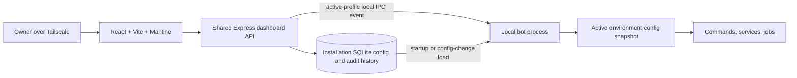

# Hellbot Admin Dashboard Architecture Plan

## Status

Architecture reference. Tasks 1–12 are implemented locally in source; VPS/Tailscale deployment remains task 13. See [local operation](../dashboard.md) for setup and verification boundaries.

## Goal

Build a private dashboard in the Hellbot monorepo to manage Hellbot-specific runtime settings for separate development and production installations. Local development runs only the Development Discord app; the VPS runs only the Production Discord app. `NODE_ENV` selects the active profile, and each installation has its own SQLite database and dashboard. The dashboard does not switch between bots, and its API permits access only to the profile selected by that process environment.

The dashboard should expose application behavior and operational controls that belong to Hellbot. It should not duplicate generic Discord server settings for guilds, channels, or roles.

## Agreed architecture

- Keep the dashboard, admin API, and bot code in the Hellbot monorepo.
- Run one Hellbot bot process with the dashboard under PM2 on each installation: Development locally and Production on the VPS. Each process uses only its environment's Discord application and credentials.
- Run the Express admin API/dashboard alongside that bot. It serves the production Vite build, validates and persists changes, and notifies only the local bot process.
- Build the UI with React, Vite, and Mantine.
- Use SQLite on the same server as the initial persistent database, outside the repository.
- Treat each installation's SQLite database as the source of truth. Its bot keeps a validated, active-profile in-memory snapshot; commands and services do not query the database on every use.
- Make the dashboard reachable only over the owner's Tailscale network.

The dashboard shows the environment selected by `NODE_ENV` and has no bot selector. The backend rejects requests for the other profile. The local dashboard can only manage Development; the VPS dashboard can only manage Production.

## Component layout



During local development, Vite may run separately and proxy API requests to the dashboard API. In production, the API serves the static dashboard bundle. The API and each bot run as separate PM2 processes so development and production have independent Discord clients and configuration lifecycles.

## Configuration lifecycle

### Startup

1. The API and bot processes on one installation open its SQLite database and apply migrations.
2. The bot process loads and validates only the profile selected by `NODE_ENV`.
3. The bot creates an in-memory snapshot with documented defaults for unset values.
4. The bot starts listeners, provider clients, and scheduled jobs using that snapshot.
5. The dashboard API serves the UI and API routes.

### Dashboard update

1. The UI submits a typed change for its active environment.
2. The API validates that the requested profile matches `NODE_ENV`, then validates the setting and value; other profiles, unknown fields, and invalid values are rejected.
3. The API commits the new value and records a sanitized audit entry in a database transaction.
4. After commit, the API sends a local IPC notification to the active bot process. API key changes notify only that bot.
5. That bot reloads and validates its profile once, atomically replaces its in-memory snapshot, and emits an in-process change event.
6. Affected services update live. Scheduled jobs that depend on changed values are cancelled and recreated where needed.

There is no periodic database polling and no database query per command or event. A database read happens at startup and after a successful configuration-change notification. If the notification or reload fails after the save, the dashboard should show that the setting is saved but not yet applied; the bot can recover from the persisted value on restart.

## Runtime configuration rules

- Add a ConfigService as the single interface for reading and changing runtime settings.
- Ordinary settings belong to the active profile. API provider keys are shared by Hellbot services within one installation; local Development and VPS Production use independent databases and keys.
- Consumers should read settings from the current profile snapshot when they run; avoid module-level copies for values expected to change live.
- Validate and atomically replace each profile snapshot. A failed save or invalid reload must leave the last valid snapshot active.
- Use one in-process event for consumers within a bot and one explicit local IPC event for cross-process notification.
- Classify settings before exposing them in the UI:
  - **Live:** provider, model, API key, AI tool availability, prefix, embed color, supported feature switches, and Hellbot feature routing where consumers can safely refresh.
  - **Restart required:** Discord bot token, gateway intents, or other startup-only connection behavior. Discord bot tokens remain PM2 environment secrets; changing them is an operational deployment action.
  - **Protected control-plane:** owner identity and network access policy remain outside ordinary dashboard edits.
  - **Secret:** AI provider keys are shared by services within one installation and encrypted at rest. Development and Production installations keep independent keys. The encryption key remains in the process environment wherever decryption is required. Secret values are returned only by the explicit key-edit endpoint to prefill the masked edit input; list/save responses and audit history exclude them.

## Hellbot-specific settings in dashboard scope

The dashboard manages application-owned behavior, not general Discord server configuration. Settings are scoped to the active environment selected by `NODE_ENV`.

| Setting | Dashboard treatment | Runtime behavior |
| --- | --- | --- |
| AI provider | Select from providers supported by Hellbot | Recreate or reconfigure the profile's provider client after save. |
| AI provider API keys | Add, replace, test, or clear keys shared by services in this installation; show metadata in lists and load the current key on demand in the masked edit input | Store encrypted values and notify the active bot after changes. Return plaintext only for explicit editing; exclude it from list/save responses and logs/audit records. |
| AI model | Enter the provider-specific model ID as text | Apply to subsequent AI requests; no maintained model catalog is required. |
| AI tools | Show registered tool names and descriptions with an individual enable/disable toggle per profile | Apply live; omit disabled tools from model requests and reject their execution, including calls from conversations already in progress. Preserve existing permission checks and record changes in activity history. |
| Prefix command prefix | Editable validated text value | Applies to future prefix parsing and help output. |
| Hellbot Discord routing | Configure home/testing server IDs, channel/category/role IDs and role-request destinations per profile | Applies to subsequent role requests and review interactions; this is a narrow Hellbot integration setting, not a general channel editor. |
| Embed color | Editable validated color value | Applies to embeds generated after the update. |
| Hellbot feature switches | Enable/disable explicitly supported Hellbot features | Each switch defines whether commands, listeners, or jobs stop immediately and how in-flight work is handled. |
| Other Hellbot-owned runtime settings | Add only after a code/config consumer audit confirms the setting is application-specific and has a safe runtime update path | Classify as live, restart-required, protected, or secret before exposing it. |

Expose per-profile guild, channel, category and role IDs used by Hellbot integrations in Bot settings. This includes home/testing servers, verification and notification destinations, creation forwarding, the Minecraft category exclusion, the verified role and staff notification role. These configure Hellbot routing; they do not edit Discord server entities or restore the removed staff permission/sync system. The reserved log channel ID is editable but currently has no consumer.

The single-owner dashboard has no application login or sessions. Owner identity and network access policy remain outside editable profile fields. Tailscale is the planned network-level access boundary; Express listens on loopback. The local dashboard manages Development and the VPS dashboard manages Production.

### AI tool controls

- Add an AI settings view listing registered tools with their names, descriptions, and individual toggles. Tool availability is configured separately for dev and prod.
- Store enabled/disabled state under `ai.tools` in each profile's configuration. Validate tool names against the application registry; the dashboard cannot define arbitrary tools.
- Initial values preserve existing tool availability and existing contextual restrictions. An enabled toggle never grants access that the invoking user's permissions or the tool's own policy would deny.
- Filter disabled tools out of every model request, including follow-up requests. Recheck the current profile configuration immediately before dispatching each tool call so a queued call from an earlier model response cannot bypass a newly disabled toggle.
- Reject a disabled tool call with a safe failure result. Disabling prevents subsequent dispatches; it does not cancel or undo an operation that has already started.
- Apply changes through the existing save and IPC lifecycle without polling or restarting the bot. Record changed tool settings in `config_history` and show them in Activity log.

## Errors and logs

Include an operational view for Hellbot errors and application logs, scoped to the active bot profile. This is observability, not configuration editing.

- Show recent structured log entries and errors with timestamp, severity, profile, source, and useful command/service context.
- Support filters by time range, severity, profile, and component or command.
- Redact Discord bot tokens, AI provider keys, and other secrets before logs are written or returned by the API.
- Define retention and storage limits. Use rotating local structured logs or another bounded store; do not grow the configuration database indefinitely with log events.
- Distinguish local application logs from Bugsnag events. Audit actual Bugsnag reporting and current logging first; the dashboard must not imply it can show events the application does not capture.

## Proposed repository layout

```text
src/
  dashboard/
    api/                 # Express routes and request handlers
    middleware/          # Allowed browser origins and request validation
  services/
    config/              # Profile ConfigService, schema, defaults, change events
    database/            # SQLite connection and migrations
    ipc/                 # Local profile-specific bot notifications
  ...
dashboard/
  src/                   # React pages and Mantine-based UI
  public/                # Static public assets
  vite.config.js
```

The actual file layout should follow the existing Hellbot organization where practical and avoid a broad source-tree migration.

## Technology stack

### Backend

- **Express** for the shared admin API and serving the production dashboard bundle.
- **SQLite** for active-profile settings, per-installation encrypted AI secrets, and audit history.
- **Zod** for validating API input and configuration values. The backend remains CommonJS to match the bot.
- **better-sqlite3** is the SQLite driver. Ordered SQL migrations run transactionally through a shared initializer, with the schema version stored in SQLite's `PRAGMA user_version`. See [database setup](../database.md).
- A local IPC mechanism (for example, Unix domain sockets) notifies the one bot process on this installation after a saved update.

### Frontend

- **React** for dashboard screens and interactive forms.
- **Vite** for local development and production asset builds.
- **Mantine** for layout, controls, forms, dialogs, and notifications.
- **@tabler/icons-react** for icons.
- An environment label for the profile selected by `NODE_ENV`; there is no profile selector.

The dashboard is a Vite frontend in the same repository, built and served by the Express API process in production. The existing bot processes remain CommonJS JavaScript; the frontend language can be finalized when scaffolding it.

## Database model and persistence

The initial database should contain:

- A profile-scoped configuration record with an update timestamp; no revision field.
- Encrypted secret values organized by provider, shared by services within this installation; return plaintext only on explicit edit requests; exclude it from other API responses and audit data.
- An audit history with profile, changed setting paths, actor, timestamp, and previous/new non-secret values. For secret changes, record only that a secret was added, replaced, tested, or cleared.
- A schema migration version.

Use a persistent data directory outside the repository. Configure SQLite for the expected local multi-process access pattern (including appropriate busy handling and journaling mode) and keep writes short. Do not use the database as an unbounded application log store.

### Database architecture

#### `profiles`

Each row represents one bot profile. Use an integer primary key; the environment is a separate field, not the profile ID.

| Column | SQLite type | Constraints / purpose |
| --- | --- | --- |
| `id` | INTEGER | Primary key, generated by SQLite. |
| `env` | TEXT | Required, unique; allowed values: `dev`, `prod`. |
| `name` | TEXT | Required; display name for the stored bot profile. |
| `profile_image_url` | TEXT | Nullable; URL of the bot profile picture displayed in the dashboard. |
| `created_at` | TEXT | Required; UTC creation timestamp. |
| `updated_at` | TEXT | Required; UTC last-update timestamp. |

Other profile-scoped tables reference `profiles.id` through an integer `profile_id` foreign key.

#### `profile_configs`

One row per profile, containing the validated configuration without secrets. No revision counter or configuration versioning mechanism is needed initially.

| Column | SQLite type | Constraints / purpose |
| --- | --- | --- |
| `profile_id` | INTEGER | Primary key and foreign key to `profiles.id`. |
| `config_json` | TEXT | Required; JSON settings validated through Zod. |
| `updated_at` | TEXT | Required; UTC last-update timestamp. |

The JSON contains provider/model selection, per-profile AI tool toggles (`ai.tools`), prefix, embed color, and supported feature switches. These do not need separate tables initially.

The frontend submits only changed fields. Within a transaction, the backend reads the current configuration, merges those fields, validates the result, and saves it together with the history entry. This prevents a stale form from overwriting unrelated changes made in another tab, without adding a revision field. Concurrent edits to the same field use the last saved value.

#### `secrets`

AI provider keys are shared by services within one installation. Use a shared `secrets` table instead of `profile_secrets`; there is no `profile_id` or `env` column. Local Development and VPS Production have separate databases and key values. Support multiple keys per provider for the bot's existing key rotation.

| Column | SQLite type | Constraints / purpose |
| --- | --- | --- |
| `id` | INTEGER | Primary key, generated by SQLite. |
| `provider` | TEXT | Required; supported AI provider identifier. |
| `label` | TEXT | Display name for the key. |
| `encrypted_value` | BLOB | Required; encrypted API key. |
| `nonce` | BLOB | Required; encryption nonce. |
| `auth_tag` | BLOB | Required; authentication tag for integrity verification. |
| `created_at` | TEXT | Required; UTC creation timestamp. |
| `updated_at` | TEXT | Required; UTC last-update timestamp. |

Keep the initial model minimal: no key-version, priority, or enable/disable fields until needed. Updating a key notifies the one bot process on this installation so it refreshes its AI clients.

#### `config_history`

Keep a simple audit history and non-secret configuration snapshots. No revision counter is required.

| Column | SQLite type | Constraints / purpose |
| --- | --- | --- |
| `id` | INTEGER | Primary key, generated by SQLite. |
| `profile_id` | INTEGER | Foreign key to `profiles.id`; nullable for shared secret changes. |
| `action` | TEXT | Required; e.g. `config_updated`, `secret_added`, `secret_replaced`, `secret_cleared`. |
| `changed_paths_json` | TEXT | Changed setting paths. |
| `config_snapshot_json` | TEXT | Non-secret configuration after a profile change; null for secret operations. |
| `metadata_json` | TEXT | Optional sanitized context, such as the provider and secret ID. |
| `actor` | TEXT | Required; administrator identity. |
| `created_at` | TEXT | Required; UTC event timestamp. |

Never store plaintext keys or previous encrypted keys in history. Avoid additional history tables or version-management machinery until there is a concrete need.

## Access and security

- Expose the dashboard API and UI only through Tailscale; do not publish its admin port to the public internet.
- Restrict access to the owner's tailnet identity/device using available Tailscale controls. The dashboard intentionally has no application login or sessions.
- Validate mutation routes server-side and require an allowed browser Origin and dashboard request header.
- Encrypt editable AI provider keys at rest using an encryption key supplied through the API process environment.
- Keep Discord bot tokens in each bot process's PM2 environment, not in the editable database or API. Never return secrets or include them in errors, logs, or audit records.
- Use safe UI errors and log server-side context without credentials.
- Keep owner identity and network access policy outside ordinary profile edits. Activity entries use the configured owner identity.

### Existing VPS Tailscale setup (checked 2026-10-19)

- Tailscale is installed and running on the VPS. Its tailnet hostname is `openclaw-vps.tailbfe083.ts.net`.
- OpenClaw's gateway binds to `127.0.0.1:18789`. Its existing tailnet HTTPS endpoint on port 443 returned the OpenClaw Control page with a valid TLS certificate. Preserve that route when adding the dashboard.
- `tailscale serve status` reported `No serve config` even though the OpenClaw HTTPS endpoint responded. Recheck the effective routing before making any Serve changes; do not reset or overwrite port 443 based on the status output alone.
- Tailscale SSH is disabled (`RunSSH: false`); the VPS uses ordinary `sshd` on port 22. This does not require changing SSH for the dashboard.

### Dashboard exposure

1. Run the Express dashboard API on a loopback address and a dedicated local port; keep that port closed to the public network.
2. Add a separate Tailscale Serve HTTPS route to that local port, using an unused tailnet HTTPS port such as 8443 after checking the existing listener and tailnet policy. Keep OpenClaw's current port 443 route intact. Do not use Funnel, which would expose the dashboard publicly.
3. Restrict the dashboard route to the owner's devices or identity in the tailnet access policy, and keep the API bound to loopback with browser-origin validation.
4. From an authorized device, verify HTTPS and dashboard/API access. From a device without access, verify the route is denied. Confirm the saved Serve route survives a VPS restart.

## Operations and failure handling

- PM2 manages the dashboard/API and one bot process per installation. Local Development and VPS Production each start with their `NODE_ENV` and matching Discord application credentials.
- Database startup or migration failures must be logged clearly and must not silently replace persisted settings with defaults.
- Invalid stored settings must not partially activate. Preserve the last valid snapshot and surface the issue for admin action.
- Use the IPC response to show whether a saved change was applied by the affected bot process; no persisted revision tracking is required initially.
- If a provider or API key changes, recreate or refresh only that profile's AI client; do not restart the Discord connection unless a setting is explicitly restart-required.
- Keep rotating logs within defined storage limits.

## Implementation phases

1. **Configuration and consumer inventory:** classify current settings by active profile, owner/control-plane, live, restart-required, and secret; map each setting to all consumers.
2. **Environment-bound process foundation:** make `NODE_ENV` select the dev or prod bot process and its separate Discord credentials.
3. **Persistence foundation:** add SQLite, schema migrations, profile-scoped settings, encrypted-secret storage, audit history, and validated defaults.
4. **Runtime configuration and notifications:** add profile ConfigServices, startup snapshot loading, change-event consumers, and local IPC notifications without polling.
5. **Admin API and security:** add active-profile read/write routes, secret-safe operations, input/browser-origin validation, and fixed owner attribution; no application login.
6. **Observability:** standardize structured logs, redact secrets, define rotation/retention, and add profile-aware error/log API routes.
7. **Dashboard UI:** scaffold React + Vite + Mantine; show the active environment and provide pages for AI settings, Hellbot behavior, feature switches, and errors/logs.
8. **Deployment:** configure PM2 for the bot and dashboard processes on local Development and VPS Production, persistent per-installation SQLite storage, a separate Tailscale Serve route that preserves OpenClaw on port 443, tailnet access rules, encrypted-secret key handling, and log retention.
9. **Manual verification:** confirm profile isolation, live application of supported changes without restarting the bot process, restart recovery, secret redaction, log filtering, and rejection of unauthorized requests.

## Initial scope boundaries

- AI system prompt management is deferred. Existing prompts remain in code; do not import them into the configuration database or expose prompt editing, preview, or history in the dashboard for now.
- A Development bot and dashboard locally, a Production bot and dashboard on the VPS, and one dashboard administrator.
- Each installation has its own SQLite database. The local database contains Development settings and the VPS database contains Production settings; API keys are managed independently per installation. No configuration revision counters are used.
- No polling and no database query per command/event; each bot reloads once on startup and after a local change notification.
- AI provider keys are editable in the dashboard and encrypted at rest; Discord bot tokens stay in PM2 environment configuration.
- No general Discord server configuration editor for guilds, channels, or roles.
- No cross-host synchronization: each dashboard writes only to its local database and notifies only its local bot.

